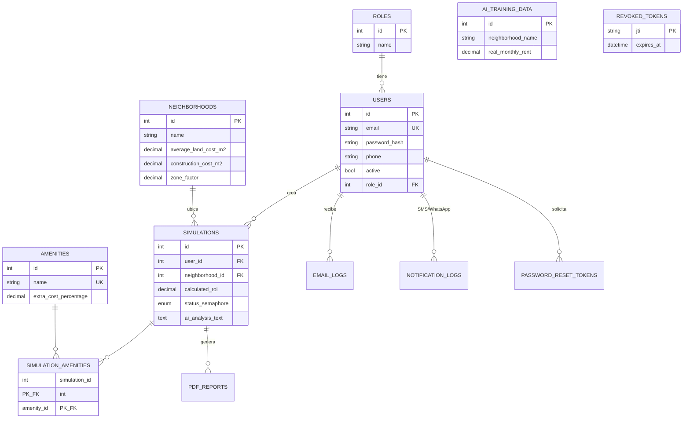

# OaxInvest · Backend (Spring Boot)

API REST del simulador de rentabilidad para construir departamentos en Oaxaca de Juárez. El usuario captura terreno, costos y renta; la API calcula ROI, tiempo de recuperación y un **semáforo** (VERDE / AMARILLO / ROJO), genera un análisis (IA) y puede enviar el reporte por **correo (Postfix)**, **SMS** y **WhatsApp (Twilio)**.

> Completa antes de entregar: URL del proyecto: `https://TU-DOMINIO.com` · URL base de la API: `https://TU-DOMINIO.com/api` · Figma: `PEGA_AQUI` · GitHub Projects: `PEGA_AQUI`

## Tecnologías
Java 17 · Spring Boot 3.3 (Web, Data JPA, Security, Validation, Mail) · MySQL 8 · Flyway · JWT (jjwt) · BCrypt · OpenPDF · Twilio · OpenAI (opcional) · Bruno · Nginx + systemd + Certbot en Vultr.

## Diagrama ER

Relación **N:M**: `simulations` ↔ `amenities` mediante `simulation_amenities`. Tablas: 12 (mínimo pedido: 5).

## Instalación local
1. MySQL 8 (no MariaDB). Crea la BD una vez: `mysql -u root -p < database/00_create_database.sql`
2. `cp src/main/resources/application.properties.example src/main/resources/application.properties` y llena usuario/contraseña de BD y `app.jwt.secret` (`openssl rand -base64 48`). Ese archivo **no se sube a Git**.
3. `./mvnw spring-boot:run` (o `mvn spring-boot:run`). Flyway crea las 12 tablas y el `DataSeeder` carga los datos de prueba.
4. API en `http://localhost:8080`.

Para probar SMS/WhatsApp llena `app.twilio.*` (en el sandbox de WhatsApp el destinatario debe haber enviado antes el código de unión a Twilio; con cuenta trial el SMS solo llega a números verificados). Cada usuario guarda su teléfono en su perfil (`PUT /api/profile`).

## Credenciales de prueba
| Rol | Correo | Contraseña |
|---|---|---|
| ADMIN (evaluación) | `admin@oaxinvest.mx` | `Admin#2026` |
| ANALISTA | `pedro@test.com` | `Analista#2026` |
| CLIENTE | `ana@test.com` | `Cliente#2026` |

Todos los usuarios `LOCAL` de prueba tienen la contraseña de su rol; los de Google/Facebook no tienen contraseña local y entran con su proveedor.

## Roles y seguridad
- **ADMIN**: todo (usuarios, dashboard, logs de correo, colonias, amenidades, dataset IA, simulaciones de todos).
- **ANALISTA**: CRUD de colonias, amenidades y dataset de IA.
- **CLIENTE**: solo sus propias simulaciones y su perfil.
- JWT en el header `Authorization: Bearer <token>`; expira en 120 min. `POST /api/auth/logout` guarda el `jti` en `revoked_tokens` (invalidación real).
- Autorización con `SecurityFilterChain` **y** `@PreAuthorize`. Contraseñas con BCrypt. Bean Validation en todos los DTO (contraseña: 8+ caracteres, mayúscula, número y carácter especial).
- Errores JSON con `@RestControllerAdvice`: 400, 401, 403, 404, 422, 500 (y 502 si Twilio/SMTP falla).

## Endpoints principales
| Método y ruta | Rol |
|---|---|
| `POST /api/auth/register · login · google · facebook · logout · forgot-password · reset-password`, `GET /api/auth/verify-email · social-config` | público (logout requiere token) |
| `GET/PUT /api/profile`, `PUT /api/profile/password`, `POST /api/profile/avatar`, `DELETE /api/profile` | autenticado |
| `GET/POST /api/simulations`, `GET/DELETE /api/simulations/{id}`, `GET …/{id}/pdf`, `POST …/{id}/send-email · send-sms · send-whatsapp` | CLIENTE, ADMIN |
| `GET /api/neighborhoods`, `/options`; `POST/PUT/DELETE` | lectura: todos · escritura: ADMIN, ANALISTA |
| `GET /api/amenities`, `/options`; `POST/PUT/DELETE` | igual que colonias |
| `/api/ai-data` (CRUD) | ADMIN, ANALISTA |
| `GET/POST/PUT /api/admin/users`, `PATCH …/{id}/activate · deactivate` | ADMIN |
| `GET /api/admin/dashboard`, `GET /api/admin/email-logs` | ADMIN |

**Paginación y filtros en el servidor** (el cliente nunca descarga todo): `?page=0&size=10&sort=roi,desc` más filtros: simulaciones `q, semaphore, userId`; usuarios `q, role, verified, active`; logs `q, type, status`; dataset `q, transport`. Respuesta: `{content, page, size, totalElements, totalPages, first, last}`.

## Fórmulas del simulador
- Costo total = área × costo/m² × (1 + suma % amenidades / 100)
- Ingreso neto mensual = renta × departamentos − gastos fijos; anual = × 12
- ROI % = ingreso neto anual / costo total × 100 · Recuperación (meses) = costo total / ingreso neto mensual
- Semáforo: VERDE ROI ≥ 15 · AMARILLO 8 ≤ ROI < 15 · ROJO ROI < 8

## Pruebas con Bruno
Abre la carpeta `bruno/OaxInvest` en Bruno, elige el entorno `local` y ejecuta en orden: login (guarda el token en `{{token}}`) → peticiones protegidas → carpeta `05-Errores` (401, 400, 403, 404, 422). Para rutas de otro rol, corre primero el login de ese rol.

## Respaldo SQL
Tras el primer arranque genera el respaldo completo (estructura + datos con usuarios hasheados):
`mysqldump -u root -p --routines simulador_oaxaca > database/backup_simulador_oaxaca.sql` y súbelo al repo.

## Despliegue
Ver `docs/DEPLOY.md` (Vultr + Nginx + Certbot + systemd + Postfix con SPF/DKIM).

## Inicio de sesión con Google y Facebook
Además de correo y contraseña, la aplicación permite entrar con Google o con Facebook. No depende del puerto 25 ni de Postfix: todo viaja por HTTPS.

1. El navegador obtiene un token del proveedor (Google Identity Services o el SDK de Facebook).
2. Lo envía a `POST /api/auth/google` (`{ "idToken": "..." }`) o `POST /api/auth/facebook` (`{ "accessToken": "..." }`).
3. El backend **verifica el token directamente con el proveedor** (`oauth2.googleapis.com/tokeninfo` y `graph.facebook.com/debug_token`) y comprueba que fue emitido para esta aplicación. No confía en lo que diga el navegador.
4. Si el correo existe, inicia sesión; si no, crea un usuario `CLIENTE` sin contraseña y con el proveedor registrado. Devuelve el mismo JWT del login normal, así que los roles y las rutas protegidas no cambian.

Los botones aparecen solo si el servidor tiene configurado el proveedor (`GET /api/auth/social-config`). Si no hay claves, la app funciona con correo y contraseña.

**Configuración (valores en `application.properties` del servidor, nunca en el repositorio):**

```properties
app.google.client-id=
app.facebook.app-id=
app.facebook.app-secret=
```

- **Google:** en [Google Cloud Console](https://console.cloud.google.com/) → APIs y servicios → Credenciales → *ID de cliente de OAuth* tipo **Aplicación web**. En *Orígenes autorizados de JavaScript* agrega `http://localhost:5173` y `https://tu-dominio.com`. En la pantalla de consentimiento, mientras esté en modo de prueba, agrega como usuarios de prueba los correos que vayan a entrar.
- **Facebook:** en [Facebook Developers](https://developers.facebook.com/) crea una app, agrega el producto *Facebook Login* y copia el ID y el identificador secreto (Configuración → Básica). En *Dominios de la app* escribe tu dominio. En modo desarrollo solo entran las cuentas con rol en la app (administradores, desarrolladores o probadores). El SDK exige HTTPS fuera de `localhost`.

**Reglas de seguridad:**
- El correo debe venir confirmado por el proveedor; si Facebook no entrega correo, se rechaza con un mensaje claro.
- Si ya existía una cuenta local **sin confirmar** con ese correo, al entrar con el proveedor se invalida su contraseña anterior, para que quien la registró sin ser dueño del correo no conserve acceso.
- Una cuenta local ya confirmada conserva su contraseña y también puede entrar con el proveedor.
- Los usuarios creados por proveedor pueden definir una contraseña desde *Perfil*.
